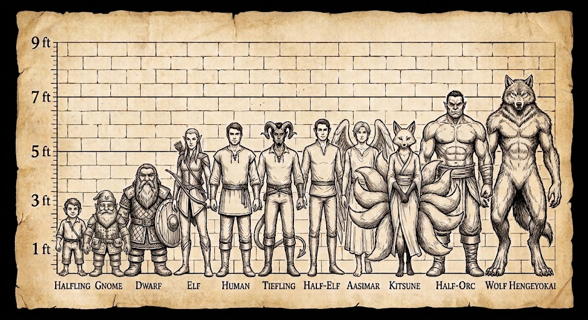

# Playable Races

Planar-touched heritages combine with a base race and replace its other special traits while retaining its ability adjustments and Size package. Each race page contains its complete traits and form rules.

| Race | Type | Brief bonuses and traits |
| --- | --- | --- |
| [Human](races/human.md) | Base race | Flexible +2 ability bonus, bonus feat, and additional skill rank per level. |
| [Elf](races/elf.md) | Base race | Choice of +2 Dexterity, Charisma, or Wisdom; senses, skills, rest, sleep protection, and weapon familiarity. |
| [Dwarf](races/dwarf.md) | Base race | +2 Constitution, darkvision, poison immunity, steady movement, and weapon familiarity. |
| [Half-Orc](races/half-orc.md) | Base race | +2 Strength and Constitution, darkvision, short-range Scent, and weapon familiarity. |
| [Halfling](races/halfling.md) | Base race | Small Size, Low-Light Vision, Stealth, and a bonus to saves and skill checks. |
| [Half-Elf](races/half-elf.md) | Base race | Flexible +2 ability bonus, Low-Light Vision, skill adaptability, keen senses, enchantment resistance, and weapon familiarity. |
| [Gnome](races/gnome.md) | Base race | Small Size, +2 Intelligence, darkvision, and Illusion benefits. |
| [Aasimar](races/aasimar.md) | Plane-touched | Choose a base race and electric or acid resistance; gains wings and fixed skill bonuses. |
| [Tiefling](races/tiefling.md) | Plane-touched | Choose a base race and fire or cold resistance; gains darkvision, a prehensile tail, and fixed skill bonuses. |
| [Hengeyokai](races/hengeyokai.md) | Spirit | Choose an animal type; gains three forms, a flexible +2 ability bonus, animal traits, and natural attacks. |
| [Kitsune](races/kitsune.md) | Spirit | Fox, hybrid, and humanoid forms; gains magical tails with selected Ioun Stone effects. |

<nav aria-label="Related pages" style="display:flex;flex-wrap:wrap;gap:.5rem;margin-top:2rem;padding-top:.75rem;border-top:1px solid #aaa;">
Related:
<a href="index.md" style="display:inline-block;padding:.35rem .65rem;border:1px solid #888;border-radius:4px;color:inherit;text-decoration:none;">Game Reference</a>
<a href="classes/index.md" style="display:inline-block;padding:.35rem .65rem;border:1px solid #888;border-radius:4px;color:inherit;text-decoration:none;">Classes</a>
<a href="alignment.md" style="display:inline-block;padding:.35rem .65rem;border:1px solid #888;border-radius:4px;color:inherit;text-decoration:none;">Alignment</a>
<a href="feats.md" style="display:inline-block;padding:.35rem .65rem;border:1px solid #888;border-radius:4px;color:inherit;text-decoration:none;">Feats</a>
</nav>
